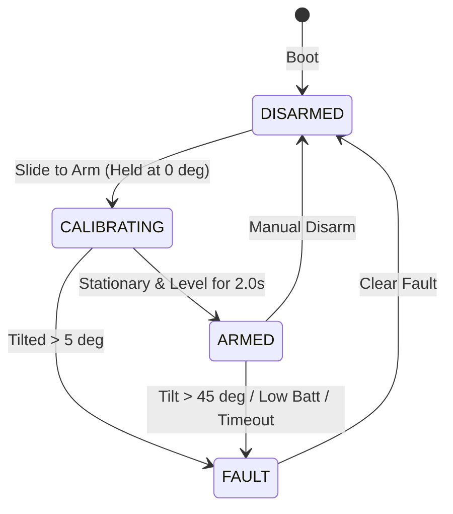

# 🤖 Chintu Robot — Physical Deployment & Operator Guide
*(Arduino Mega 2560 + Raspberry Pi + Modern Web HUD)*

This document is the authoritative step-by-step field runbook for deploying, calibrating, and physically operating the **Chintu Two-Wheeled Legged Balancing Robot** directly from the web teleoperation dashboard.

---

## 🎯 Master Deployment Matrix (Kaunsa Code Kis Device me Jayega)

| Target Hardware Device | Which Repository / Folder | Which Git Branch | Purpose & What It Runs | Exact Flashing / Running Command |
|---|---|---|---|---|
| **Arduino Mega 2560** (Real-Time Controller) | `chintutherobo/robot/firmware/` | **`main`** | 200 Hz PID Self-Balance, Timer3/4 Stepper ISR, 6x Servo IK, MPU-6050, E-Stop | Open with PlatformIO in VS Code & click **Upload**, or: `pio run -e megaatmega2560 --target upload` |
| **Raspberry Pi 4 / 5** (Host Supervisor & Server) | `chintutherobo/robot/` (`backend/` + `web-ui/`) | **`main`** | FastAPI REST & WebSocket Server, 300ms Watchdog, Token Auth, Hotspot, Telemetry | Run `bash scripts/install_env.sh`, then: `python3 -m backend.server` (Port 3456) |
| **Operator Phone / Laptop** (Dashboard Controller)| No software installation needed | — | Web Teleoperation HUD, Virtual Joystick, 3D Digital Twin, Height Slider, E-Stop | Open Chrome / Safari at: `http://<PI_IP>:3456` (or `http://192.168.4.1:3456`) |
| *(Optional Bench Test)* **Arduino Mega 2560** | `chintu-defence-bot/arduino/tests/` | **`feature/chintu-defence-bot`** | Single motor / sensor unit test only (NO balance, NO dashboard) | Open isolated test `.ino` sketch in Arduino IDE & upload |

> [!IMPORTANT]
> **GOLDEN RULE FOR PHYSICAL ROBOT OPERATION:**
> - Robot ko balance aur dashboard se chalane ke liye **SIRF aur SIRF `main` branch (`chintutherobo`)** ka code use hoga.
> - Raspberry Pi par `chintu-defence-bot` ka code **kabhi mat daalna** (kyunki usme Web HUD aur WebSocket nahi hai).
> - Dono repos ke files ko aapas me mix ya overwrite mat karna.

---

## 📑 Table of Contents
1. [System Architecture & Wiring Summary](#1-system-architecture--wiring-summary)
2. [Phase 1: Flash Arduino Mega 2560 Firmware](#phase-1-flash-arduino-mega-2560-firmware)
3. [Phase 2: Raspberry Pi Supervisor Setup](#phase-2-raspberry-pi-supervisor-setup)
4. [Phase 3: Web Dashboard Access & Authentication](#phase-3-web-dashboard-access--authentication)
5. [Phase 4: Bench Calibration & Pre-Flight Checklist (Hawa Me Test)](#phase-4-bench-calibration--pre-flight-checklist)
6. [Phase 5: First Arming & Self-Balancing Sequence](#phase-5-first-arming--self-balancing-sequence)
7. [Phase 6: Driving & Joint Height Adjustment](#phase-6-driving--joint-height-adjustment)
8. [Troubleshooting & Fault Recovery Manual](#troubleshooting--fault-recovery-manual)

---

## 1. System Architecture & Wiring Summary

```
                                [ 3S LiPo Battery: 11.1V - 12.6V ]
                                                │
                                   [ Main Fuse 30A + E-Stop ]
                                                │
       ┌────────────────────────────────────────┼────────────────────────────────────────┐
       ▼                                        ▼                                        ▼
[ XL4016 E1 Buck Converter ]           [ 5.1V 4A Buck Converter ]                [ 12V Motor Rail ]
  (Step-down to 6.0V 8A-10A)                (Raspberry Pi Power)                 (VMOT + 100µF Caps)
       │                                        │                                        │
       ▼ (Screw Terminal V+)                    ▼                                        ▼
[ PCA9685 Servo Controller ]             Raspberry Pi 4 / 5                    [ Dual A4988 Drivers ]
  (16-Ch 12-Bit PWM I2C)                        │                               (Step / Dir / Enable)
       │                                (USB Serial Cable)                               │
       ├─────────────────────┐                  ▼                                        │
       ▼                     ▼          Arduino Mega 2560 ◄──────────────────────────────┘
 3x MG995 Servos      3x MG996R Servos          │
 (Roll / Leg Joints)  (High-Torque Pitch)       ├─────────────────► PCA9685 (SDA:20, SCL:21)
                                                └─────────────────► MPU-6050 (SDA:20, SCL:21)
                                                                    2x NEMA17 Stepper Motors ◄───┘
```

> [!CAUTION]
> **Star-Grounding Mandate:** All GND lines (Battery -, XL4016 E1 OUT-, Pi GND, Mega GND, PCA9685 GND, A4988 GND) **MUST** meet at a single central star terminal block. High transient currents (~10-12A during simultaneous servo & stepper acceleration) will brown out the microcontroller if ground loops exist.

---

### Hardware Modules & Interface Specifications

#### 1. XL4016 E1 High-Power DC-DC Buck Converter
- **Input:** 3S LiPo ($11.1\text{V} - 12.6\text{V}$) via Main 30A Fuse and Safety Switch.
- **Output:** Tuned via onboard multi-turn precision brass potentiometer to **$6.00\text{ V DC}$**.
- **Current Rating:** Up to $8\text{A}$ continuous ($10\text{A}$ peak with heatsink cooling).
- **Connection:** Output `OUT+` connects directly to the high-current `V+` screw terminal of the **PCA9685**, and `OUT-` connects to the central star ground bus.
- **Multimeter Pre-Flight Check:** *Always verify output voltage with a digital multimeter before plugging in PCA9685 or servos! Over-voltage (> 7.2V) will burn MG995/MG996 servos.*

#### 2. PCA9685 16-Channel 12-Bit PWM I2C Servo Controller
- **Power Terminals:**
  - `V+` (Green Screw Terminal): Receives **6.0V** high-current rail from XL4016 E1 buck converter.
  - `GND` (Green Screw Terminal): Receives ground from XL4016 E1 and Central Star Ground.
- **Logic Header (To Arduino Mega 2560):**
  - `VCC` $\rightarrow$ Arduino Mega **5V** logic pin.
  - `GND` $\rightarrow$ Arduino Mega **GND**.
  - `SDA` $\rightarrow$ Arduino Mega **Pin 20** (I2C Data, shared with MPU-6050).
  - `SCL` $\rightarrow$ Arduino Mega **Pin 21** (I2C Clock, shared with MPU-6050).
  - `OE` (Output Enable) $\rightarrow$ Tied to **GND** (Always enabled active-low).
- **I2C Address:** Default `0x40` (all address solder jumpers open).

#### 3. Servo Allocation: 3x MG995 + 3x MG996R (Channels 0 – 5)
High-torque **MG996R** metal gear servos ($11.0\text{ kg}\cdot\text{cm}$) are assigned to heavy load-bearing pitch/thigh axes, while **MG995** servos ($10.0\text{ kg}\cdot\text{cm}$) are assigned to roll balance and knee joints:

| PCA9685 Channel | Joint / Axis | Servo Model | Gear Type | Operating Voltage | Function |
|---|---|---|---|---|---|
| **Channel 0** | **Left Hip Roll** | **MG995** | Metal | 6.0V (XL4016) | Lateral tilt / stance trim |
| **Channel 1** | **Left Hip Pitch (Thigh $L_2$)** | **MG996R** | Metal | 6.0V (XL4016) | High-torque forward/back leg swing |
| **Channel 2** | **Left Knee (Shank $L_3$)** | **MG996R** | Metal | 6.0V (XL4016) | Dynamic leg height / knee flexion |
| **Channel 3** | **Right Hip Roll** | **MG995** | Metal | 6.0V (XL4016) | Lateral tilt / stance trim |
| **Channel 4** | **Right Hip Pitch (Thigh $L_2$)** | **MG996R** | Metal | 6.0V (XL4016) | High-torque forward/back leg swing |
| **Channel 5** | **Right Knee (Shank $L_3$)** | **MG995** | Metal | 6.0V (XL4016) | Dynamic leg height / knee flexion |

#### 4. Dual A4988 Stepper Drivers & Arduino Mega Interface
Driving 2x NEMA 17 Bipolar Steppers ($1.8^\circ/\text{step}$, $1.2\text{A}$–$1.5\text{A}$ rating):
- **Motor Voltage Rail:** `VMOT` $\rightarrow$ $12\text{V}$ LiPo bus through fuse.
- **Decoupling Protection:** Place a **$100\,\mu\text{F}$ 25V+ electrolytic capacitor** directly across `VMOT` and `GND` at each A4988 pin header to protect FETs from inductive inductive back-EMF spikes.
- **Logic Power:** `VDD` $\rightarrow$ Arduino Mega **5V**, `GND` $\rightarrow$ Mega **GND**.
- **Control Interface (Arduino Mega 2560):**
  - **Left Driver:** `STEP` $\rightarrow$ **Pin 5** (Timer3 CTC), `DIR` $\rightarrow$ **Pin 6**.
  - **Right Driver:** `STEP` $\rightarrow$ **Pin 7** (Timer4 CTC), `DIR` $\rightarrow$ **Pin 8**.
  - **Global Enable:** `ENABLE` $\rightarrow$ **Pin 4** (Active LOW, pulled LOW to energize coils).
  - **Sleep / Reset:** Connect `RESET` to `SLEEP` together on each A4988 driver board.
- **Microstepping Jumpers (1/16 Microstepping):**
  - Pull `MS1`, `MS2`, `MS3` all **HIGH** (tie to $5\text{V}$ rail) $\rightarrow$ Sets driver to **sixteenth-step mode** ($3200\text{ steps/revolution}$, matching firmware `STEPS_PER_REV 3200.0f`).
- **A4988 Current Limit ($V_{\text{ref}}$) Calibration:**
  $$\text{Target } I_{\text{Trip}} = 1.0\text{A} - 1.2\text{A}$$
  $$V_{\text{ref}} = I_{\text{Trip}} \times 8 \times R_{\text{sense}}$$
  *(For standard boards with $R_{\text{sense}} = 0.10\,\Omega$ [marked R100], adjust potentiometer using ceramic screwdriver until multimeter reads **$0.80\text{V} - 0.88\text{V}$** between trimpot wiper and GND).*

---

### Canonical Arduino Mega 2560 Pin Allocation
| Subsystem | Signal Name | Mega 2560 Pin | Direction / Mode | Description |
|---|---|---|---|---|
| **MPU-6050 IMU** | SDA | **Pin 20** | Bidirectional (I2C) | 400 kHz Fast-Mode (Address `0x68`) |
| **MPU-6050 IMU** | SCL | **Pin 21** | Output (I2C) | I2C Clock Line |
| **PCA9685 Servos** | SDA | **Pin 20** | Bidirectional (I2C) | 400 kHz Fast-Mode (Address `0x40`) |
| **PCA9685 Servos** | SCL | **Pin 21** | Output (I2C) | Shared Hardware I2C Clock |
| **Left A4988 Stepper** | STEP | **Pin 5** | Output (Timer3 CTC) | Fast pulse generation via OCR3A |
| **Left A4988 Stepper** | DIR | **Pin 6** | Digital Output | Left wheel direction |
| **Right A4988 Stepper**| STEP | **Pin 7** | Output (Timer4 CTC) | Fast pulse generation via OCR4A |
| **Right A4988 Stepper**| DIR | **Pin 8** | Digital Output | Right wheel direction |
| **A4988 Drivers Enable**| EN | **Pin 4** | Digital Output | Active LOW (LOW=Torque, HIGH=Coast) |
| **Battery Sense** | V_BATT | **Pin A0** | Analog In (ADC) | Calibrated voltage divider ($4.2\times$) |
| **Hardware E-Stop**| ESTOP | **Pin 2** | Input (Pull-up) | Pull to GND trips immediate ESTOP |
| **Status Indicator**| LED | **Pin 13** | Output | Built-in Diagnostic Heartbeat LED |
*(Note: If operating without PCA9685, Timer5 direct pins 44, 45, 46, 11, 12, 38 remain compatible as direct servo outputs).*

---

## Phase 1: Flash Arduino Mega 2560 Firmware

The microcontroller firmware runs a real-time **200 Hz PID balance loop**, Timer3/Timer4 direct ISR pulse generation, and 6-channel inverse kinematics.

### Step 1.1: Connect Arduino to PC
Connect the Arduino Mega 2560 to your PC via a USB-B cable.

### Step 1.2: Build and Flash via PlatformIO
Open your terminal in the project directory:
```bash
# 1. Navigate to firmware directory
cd "robot/firmware"

# 2. Build the project (-O3 optimized binary)
pio run -e megaatmega2560

# 3. Flash to Arduino Mega
pio run -e megaatmega2560 --target upload
```

> [!NOTE]
> Agar PlatformIO CLI install nahi hai, to aap **VS Code** me **PlatformIO IDE extension** install karke `firmware` folder open karein aur neeche status bar me **✓ (Build)** aur **➜ (Upload)** button press karein.

---

## Phase 2: Raspberry Pi Supervisor Setup

Raspberry Pi acts as the communication bridge, Wi-Fi hotspot, and teleoperation host.

### Step 2.1: Transfer Files to Raspberry Pi
Raspberry Pi par code clone karein ya copy karein:
```bash
git clone https://github.com/abhinavcheepa/chintutherobo.git /home/pi/chintutherobo
cd /home/pi/chintutherobo/robot
```

### Step 2.2: Python Virtual Environment & Dependencies
```bash
cd /home/pi/chintutherobo/robot/backend

# Create virtualenv
python3 -m venv venv
source venv/bin/activate

# Install required packages
pip install -r requirements.txt
```

### Step 2.3: Generate Secure Authentication Token
Chintu supervisor bina authenticated token ke launch nahi hota. Ek cryptographically secure token create karein:
```bash
# Token generate karein
python3 scripts/gen_token.py
# Example output: e9K8v_wB0g2_xJmZ8e7vW1... (isko copy karke rakhein!)
```

### Step 2.4: Set Environment Secrets (`/etc/chintu.env`)
Run the automated environment installer:
```bash
sudo bash scripts/install_env.sh
```
Ya manual file create karein `/etc/chintu.env`:
```ini
ROBOT_ENVIRONMENT=production
ROBOT_AUTH_TOKEN="Aapka_Generated_32_Character_Token_Yahan"
ROBOT_SERIAL_PORT=/dev/ttyACM0
ROBOT_SERIAL_BAUD=250000
ROBOT_HOST=0.0.0.0
ROBOT_PORT=3456
```

### Step 2.5: Connect Arduino USB to Raspberry Pi
Arduino Mega 2560 ko Raspberry Pi ke USB 3.0 port me plug karein. Verify karein:
```bash
ls -l /dev/ttyACM* /dev/ttyUSB*
# Standard path: /dev/ttyACM0
```

### Step 2.6: Start the Supervisor Server
**Option A: Manual Start (Development & Testing)**
```bash
cd /home/pi/chintutherobo/robot/backend
source venv/bin/activate
export $(cat /etc/chintu.env | xargs)
python3 -m backend.server
```

**Option B: Auto-start on Boot (Systemd Daemon)**
```bash
sudo cp scripts/chintu.service /etc/systemd/system/
sudo systemctl daemon-reload
sudo systemctl enable --now chintu.service

# Check status
sudo systemctl status chintu.service
```

---

## Phase 3: Web Dashboard Access & Authentication

```
[ Mobile / Laptop ] ──── Wi-Fi ────> [ Raspberry Pi (192.168.4.1:3456) ]
```

1. **Connect to Wi-Fi:**
   - Agar Pi ka Hotspot use kar rahe hain: Connect to `ChintuRobot_XXXX` (Password: generated by `setup_hotspot.sh`).
   - Agar Home Wi-Fi par hain: Make sure laptop/phone aur Pi same router par hain.
2. **Open Browser:**
   - Chrome / Firefox / Safari me navigate karein:
     `http://192.168.4.1:3456` (ya `http://<Raspberry_Pi_IP>:3456`)
3. **Enter Token:**
   - Dashboard aate hi ek **Supervisor Authentication Modal** pop-up hoga.
   - Apna `ROBOT_AUTH_TOKEN` paste karein aur **CONNECT** click karein.
4. **Verify Top Status Bar:**
   - `CONN`: **ONLINE** (Green)
   - `ROLE`: **CONTROLLER** (Primary locking active)
   - `STATE`: **DISARMED** (Cyan)
   - `BATT`: **11.4V - 12.6V** (Green)

---

## Phase 4: Bench Calibration & Pre-Flight Checklist

> [!WARNING]
> **ZAMEEN PAR SEEDHA CHALANE KI GALTI NA KAREIN!**
> Pehle robot ko kisi bench stand / box par aise rakhein ki dono wheels hawa me free ghoom sakein.

```
       [ CHINTU ROBOT ]
         |         |
      [Wheel]   [Wheel]
         |         |
   ═══════════════════════ (HAWA ME HANGING)
   ┌─────────────────────┐
   │    BENCH STAND      │
   └─────────────────────┘
```

### 1. Power & Buck Converter Multimeter Verification
1. Main battery connect karein lekin servos ko abhi PCA9685 se unplug rakhein.
2. Multimeter probe ko **XL4016 E1 OUT+ aur OUT-** par lagayein.
3. Potentiometer rotate karke **exact 6.00V DC** set karein.
4. Verify karein ki A4988 driver modules par $V_{\text{ref}}$ tuned hai ($0.80\text{V} - 0.88\text{V}$) aur heatsinks theek se glued hain.
5. Ab power off karke sabhi 3x MG995 aur 3x MG996R servos ko PCA9685 ke Channels 0-5 par securely plug karein.

### 2. Servo Neutral Calibration (Calibrate Tab)
1. Dashboard par **Calibrate** tab par click karein.
2. Sabhi 6 servos ke horn 90-degree zero-position par aligned hone chahiye:
   - Thigh joints ($L_2$) and Shank joints ($L_3$) standard symmetric stance me set karein.
   - Agar koi joint tedha hai, to slider se microsecond trim adjust karein aur **Save to EEPROM** click karein.

### 3. Stepper Rotation Direction Check (A4988)
1. Dashboard me robot ko arm karein (stand par rehte hue).
2. Joystick ko aage push karein:
   - **Dono wheels aage (forward) rotate hone chahiye.**
   - Agar koi wheel reverse ghoom raha hai, to power off karke stepper motor 4-pin plug ko 180° flip karein ya firmware me `invert_l_` / `invert_r_` toggle karein.

### 4. Clear Gate 1 (Bench Stand)
1. Dashboard ke **Drive** tab par scroll down karke Bench Checklist me **Gate 1 (Bench Stand Test)** checkbox ko tick karein.

---

## Phase 5: First Arming & Self-Balancing Sequence



### Crucial Arming Rules:
1. **Vertical Hold:** Robot ko dono haath se bilkul sidha vertical balance orientation ($0^\circ \text{ pitch}, 0^\circ \text{ roll}$) me pakad kar rakhein.
2. **Execute Slide-to-Arm:** Dashboard me green **SLIDE TO ARM ROBOT ❯❯** slider ko right side slide karein.
3. **2-Second Wait:** Robot 2 seconds ke liye `CALIBRATING` state me rahega (gyro biases zero karta hai). **Is 2 second me robot ko hilayein nahi!**
4. **Transition to `ARMED`:**
   - 2 seconds baad robot `ARMED` ho jayega aur motors torque engage kar lengi.
5. **Feel the PID Torque:**
   - Robot ko thoda sa aage tilt karein $\rightarrow$ Wheels aage tezi se ghoom kar balance banane ki koshish karenge.
   - Robot ko peeche tilt karein $\rightarrow$ Wheels peeche rotate honge.
6. **Place Gently on Smooth Floor:**
   - Ab robot ko flat zameen par gently release karein.
   - Robot khud ko stable vertical stance me balance karega.

---

## Phase 6: Driving & Joint Height Adjustment

### 1. Virtual Touch Joystick
- **Forward / Reverse:** Touch joystick ko upar/neeche drag karein (ya keyboard `W` / `S` / `Up` / `Down` use karein).
- **Steering:** Joystick ko left/right drag karein (`A` / `D` / `Left` / `Right`).

### 2. Height Adjustment Slider
- Dashboard me **Target Leg Height** slider ko adjust karein ($85\text{ mm} - 175\text{ mm}$):
  - **$135\text{ mm}$:** Nominal driving balance (optimal center-of-mass).
  - **$85\text{ mm}$:** Low crouch stance (high stability, low center of gravity).
  - **$170\text{ mm}$:** High tall stance.
- Robot balance banaye rakhte hue dynamically apni height change karega.

### 3. Emergency Stop (E-STOP) Procedures
Agar robot balance kho de ya obstacle samne aa jaye:
- **Big Red E-STOP Button:** Dashboard par kahi bhi tap karein.
- **Keyboard Shortcut:** `Spacebar` ya `Escape` press karein.
- **Hardware E-Stop:** Physical button press karein (Pin 2 grounded).
- Motors ka torque turant cut (tri-state) ho jayega aur robot soft limp mode me chala jayega.

---

## Troubleshooting & Fault Recovery Manual

| Issue / Error Displayed | Cause | Resolution |
|---|---|---|
| **`CANNOT ARM: LOW BATT (<11.4V)`** | Battery voltage below arming threshold (rest < 11.4V) | 3S LiPo battery charge karein. Agar bench supply par hain, supply ko 12.0V set karein. |
| **`CANNOT ARM: STALE TELEMETRY`** | WebSocket connection packet age > 300ms | Wi-Fi signal check karein; verify Pi serial connection to Mega (`/dev/ttyACM0`). |
| **`TILT FAULT` on arming** | Robot was not upright during 2s calibration | Robot ko haath se bilkul sidha pakdein ($<5^\circ$ tilt) aur dobara slide to arm karein. |
| **`SERIAL LINK DOWN`** | Mega disconnected or wrong port | Check USB cable between Mega and Pi. Verify `ROBOT_SERIAL_PORT` in `/etc/chintu.env`. |
| **Servos vibrating or resetting Pi / Mega** | High current draw / brownout | Common star-ground wire check karein; XL4016 E1 buck converter output check karein (must be 6.0V under load, not dropping); ensure PCA9685 V+ screw terminal is firmly tightened. |
| **Steppers vibrating / missing steps** | A4988 $V_{\text{ref}}$ incorrect or microstepping pins floating | Verify MS1, MS2, MS3 are tied HIGH (5V) for 1/16 microstepping; tune A4988 trimpot to $0.80\text{V} - 0.88\text{V}$; install heatsinks. |
| **PCA9685 Servos Not Responding** | I2C communication fault | Check SDA (Pin 20) and SCL (Pin 21) connections between Mega and PCA9685; verify OE pin is grounded; confirm I2C address is `0x40`. |
| **Robot runs away in one direction** | Pitch trim or IMU orientation offset | Dashboard Tune tab me jakar pitch trim calibrate karein. |
