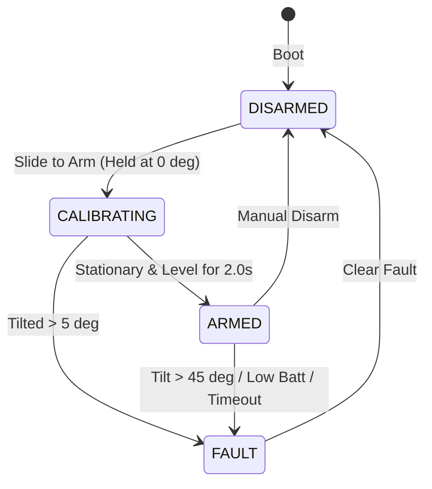

# 🤖 Chintu Robot — Physical Deployment & Operator Guide
*(Arduino Mega 2560 + Raspberry Pi + Modern Web HUD)*

This document is the authoritative step-by-step field runbook for deploying, calibrating, and physically operating the **Chintu Two-Wheeled Legged Balancing Robot** directly from the web teleoperation dashboard.

---

## 📑 Table of Contents
1. [System Architecture & Wiring Summary](#1-system-architecture--wiring-summary)
2. [Phase 1: Flash Arduino Mega 2560 Firmware](#phase-1-flash-arduino-mega-2560-firmware)
3. [Phase 2: Raspberry Pi Supervisor Setup](#phase-2-raspberry-pi-supervisor-setup)
4. [Phase 3: Web Dashboard Access & Authentication](#phase-3-web-dashboard-access--authentication)
5. [Phase 4: Bench Calibration & Pre-Flight Checklist (Hawa Me Test)](#phase-4-bench-calibration--pre-flight-checklist)
6. [Phase 5: First Arming & Self-Balancing Sequence](#phase-5-first-arming--self-balancing-sequence)
7. [Phase 6: Driving & Joint Height Adjustment](#phase-6-driving--joint-height-adjustment)
8. [Troubleshooting & Fault Recovery Manual](#troubleshooting--fault-recovery-manual)

---

## 1. System Architecture & Wiring Summary

```
                      [ 3S LiPo Battery: 11.1V - 12.6V ]
                                      │
                         [ Main Fuse 30A + E-Stop ]
                                      │
     ┌────────────────────────────────┼──────────────────────────────────┐
     ▼                                ▼                                  ▼
[ 6.0V 15A BEC ]            [ 5.1V 4A Buck ]                  [ 12V Motor Rail ]
  (Servo Power)               (Raspberry Pi)                   (A4988 / TMC2209)
     │                                │                                  │
     ▼                                ▼                                  ▼
6x MG995 Servos              Raspberry Pi 4 / 5                2x NEMA17 Steppers
                                      │
                              (USB Serial Cable)
                                      ▼
                             Arduino Mega 2560
                                      │
                               MPU-6050 (I2C)
```

> [!CAUTION]
> **Star-Grounding Mandate:** All GND lines (Battery -, BEC -, Pi GND, Mega GND, Driver GND) **MUST** meet at a single central star terminal. High servo currents (~12-15A transient) will brown out the microcontroller if ground loops exist.

### Canonical Arduino Mega 2560 Pin Allocation
| Subsystem | Signal Name | Mega 2560 Pin | Direction / Mode | Description |
|---|---|---|---|---|
| **MPU-6050 IMU** | SDA | **Pin 20** | Bidirectional (I2C) | 400 kHz Fast-Mode |
| **MPU-6050 IMU** | SCL | **Pin 21** | Output (I2C) | I2C Clock |
| **Left Stepper** | STEP | **Pin 5** | Output (Timer3 CTC) | Fast pulse generation via OCR3A |
| **Left Stepper** | DIR | **Pin 6** | Digital Output | Left wheel direction |
| **Right Stepper** | STEP | **Pin 7** | Output (Timer4 CTC) | Fast pulse generation via OCR4A |
| **Right Stepper** | DIR | **Pin 8** | Digital Output | Right wheel direction |
| **Steppers Enable**| EN | **Pin 4** | Digital Output | Active LOW (LOW=Torque, HIGH=Coast) |
| **Left Hip Roll** | SERVO 1 | **Pin 44** | Timer5 PWM | Lateral roll adjustment |
| **Left Hip Pitch**| SERVO 2 | **Pin 45** | Timer5 PWM | Thigh flexion joint |
| **Left Knee** | SERVO 3 | **Pin 46** | Timer5 PWM | Knee bend joint |
| **Right Hip Roll**| SERVO 4 | **Pin 11** | Timer5 PWM | Lateral roll adjustment |
| **Right Hip Pitch**| SERVO 5 | **Pin 12** | Timer5 PWM | Thigh flexion joint |
| **Right Knee** | SERVO 6 | **Pin 38** | Digital PWM | Knee bend joint |
| **Battery Sense** | V_BATT | **Pin A0** | Analog In (ADC) | Calibrated voltage divider ($4.2\times$) |
| **Hardware E-Stop**| ESTOP | **Pin 2** | Input (Pull-up) | Pull to GND trips immediate ESTOP |

---

## Phase 1: Flash Arduino Mega 2560 Firmware

The microcontroller firmware runs a real-time **200 Hz PID balance loop**, Timer3/Timer4 direct ISR pulse generation, and 6-channel inverse kinematics.

### Step 1.1: Connect Arduino to PC
Connect the Arduino Mega 2560 to your PC via a USB-B cable.

### Step 1.2: Build and Flash via PlatformIO
Open your terminal in the project directory:
```bash
# 1. Navigate to firmware directory
cd "robot/firmware"

# 2. Build the project (-O3 optimized binary)
pio run -e megaatmega2560

# 3. Flash to Arduino Mega
pio run -e megaatmega2560 --target upload
```

> [!NOTE]
> Agar PlatformIO CLI install nahi hai, to aap **VS Code** me **PlatformIO IDE extension** install karke `firmware` folder open karein aur neeche status bar me **✓ (Build)** aur **➜ (Upload)** button press karein.

---

## Phase 2: Raspberry Pi Supervisor Setup

Raspberry Pi acts as the communication bridge, Wi-Fi hotspot, and teleoperation host.

### Step 2.1: Transfer Files to Raspberry Pi
Raspberry Pi par code clone karein ya copy karein:
```bash
git clone https://github.com/abhinavcheepa/chintutherobo.git /home/pi/chintutherobo
cd /home/pi/chintutherobo/robot
```

### Step 2.2: Python Virtual Environment & Dependencies
```bash
cd /home/pi/chintutherobo/robot/backend

# Create virtualenv
python3 -m venv venv
source venv/bin/activate

# Install required packages
pip install -r requirements.txt
```

### Step 2.3: Generate Secure Authentication Token
Chintu supervisor bina authenticated token ke launch nahi hota. Ek cryptographically secure token create karein:
```bash
# Token generate karein
python3 scripts/gen_token.py
# Example output: e9K8v_wB0g2_xJmZ8e7vW1... (isko copy karke rakhein!)
```

### Step 2.4: Set Environment Secrets (`/etc/chintu.env`)
Run the automated environment installer:
```bash
sudo bash scripts/install_env.sh
```
Ya manual file create karein `/etc/chintu.env`:
```ini
ROBOT_ENVIRONMENT=production
ROBOT_AUTH_TOKEN="Aapka_Generated_32_Character_Token_Yahan"
ROBOT_SERIAL_PORT=/dev/ttyACM0
ROBOT_SERIAL_BAUD=250000
ROBOT_HOST=0.0.0.0
ROBOT_PORT=8765
```

### Step 2.5: Connect Arduino USB to Raspberry Pi
Arduino Mega 2560 ko Raspberry Pi ke USB 3.0 port me plug karein. Verify karein:
```bash
ls -l /dev/ttyACM* /dev/ttyUSB*
# Standard path: /dev/ttyACM0
```

### Step 2.6: Start the Supervisor Server
**Option A: Manual Start (Development & Testing)**
```bash
cd /home/pi/chintutherobo/robot/backend
source venv/bin/activate
export $(cat /etc/chintu.env | xargs)
python3 -m backend.server
```

**Option B: Auto-start on Boot (Systemd Daemon)**
```bash
sudo cp scripts/chintu.service /etc/systemd/system/
sudo systemctl daemon-reload
sudo systemctl enable --now chintu.service

# Check status
sudo systemctl status chintu.service
```

---

## Phase 3: Web Dashboard Access & Authentication

```
[ Mobile / Laptop ] ──── Wi-Fi ────> [ Raspberry Pi (192.168.4.1:8765) ]
```

1. **Connect to Wi-Fi:**
   - Agar Pi ka Hotspot use kar rahe hain: Connect to `ChintuRobot_XXXX` (Password: generated by `setup_hotspot.sh`).
   - Agar Home Wi-Fi par hain: Make sure laptop/phone aur Pi same router par hain.
2. **Open Browser:**
   - Chrome / Firefox / Safari me navigate karein:
     `http://192.168.4.1:8765` (ya `http://<Raspberry_Pi_IP>:8765`)
3. **Enter Token:**
   - Dashboard aate hi ek **Supervisor Authentication Modal** pop-up hoga.
   - Apna `ROBOT_AUTH_TOKEN` paste karein aur **CONNECT** click karein.
4. **Verify Top Status Bar:**
   - `CONN`: **ONLINE** (Green)
   - `ROLE`: **CONTROLLER** (Primary locking active)
   - `STATE`: **DISARMED** (Cyan)
   - `BATT`: **11.4V - 12.6V** (Green)

---

## Phase 4: Bench Calibration & Pre-Flight Checklist

> [!WARNING]
> **ZAMEEN PAR SEEDHA CHALANE KI GALTI NA KAREIN!**
> Pehle robot ko kisi bench stand / box par aise rakhein ki dono wheels hawa me free ghoom sakein.

```
       [ CHINTU ROBOT ]
         |         |
      [Wheel]   [Wheel]
         |         |
   ═══════════════════════ (HAWA ME HANGING)
   ┌─────────────────────┐
   │    BENCH STAND      │
   └─────────────────────┘
```

### 1. Servo Neutral Calibration (Calibrate Tab)
1. Dashboard par **Calibrate** tab par click karein.
2. Sabhi 6 servos ke horn 90-degree zero-position par aligned hone chahiye:
   - Thigh joints ($L_2$) and Shank joints ($L_3$) standard symmetric stance me set karein.
   - Agar koi joint tedha hai, to slider se microsecond trim adjust karein aur **Save to EEPROM** click karein.

### 2. Stepper Rotation Direction Check
1. Dashboard me robot ko arm karein (stand par rehte hue).
2. Joystick ko aage push karein:
   - **Dono wheels aage (forward) rotate hone chahiye.**
   - Agar koi wheel reverse ghoom raha hai, to stepper motor cable ko ulta karein ya firmware me `invert_l_` / `invert_r_` toggle karein.

### 3. Clear Gate 1 (Bench Stand)
1. Dashboard ke **Drive** tab par scroll down karke Bench Checklist me **Gate 1 (Bench Stand Test)** checkbox ko tick karein.

---

## Phase 5: First Arming & Self-Balancing Sequence



### Crucial Arming Rules:
1. **Vertical Hold:** Robot ko dono haath se bilkul sidha vertical balance orientation ($0^\circ \text{ pitch}, 0^\circ \text{ roll}$) me pakad kar rakhein.
2. **Execute Slide-to-Arm:** Dashboard me green **SLIDE TO ARM ROBOT ❯❯** slider ko right side slide karein.
3. **2-Second Wait:** Robot 2 seconds ke liye `CALIBRATING` state me rahega (gyro biases zero karta hai). **Is 2 second me robot ko hilayein nahi!**
4. **Transition to `ARMED`:**
   - 2 seconds baad robot `ARMED` ho jayega aur motors torque engage kar lengi.
5. **Feel the PID Torque:**
   - Robot ko thoda sa aage tilt karein $\rightarrow$ Wheels aage tezi se ghoom kar balance banane ki koshish karenge.
   - Robot ko peeche tilt karein $\rightarrow$ Wheels peeche rotate honge.
6. **Place Gently on Smooth Floor:**
   - Ab robot ko flat zameen par gently release karein.
   - Robot khud ko stable vertical stance me balance karega.

---

## Phase 6: Driving & Joint Height Adjustment

### 1. Virtual Touch Joystick
- **Forward / Reverse:** Touch joystick ko upar/neeche drag karein (ya keyboard `W` / `S` / `Up` / `Down` use karein).
- **Steering:** Joystick ko left/right drag karein (`A` / `D` / `Left` / `Right`).

### 2. Height Adjustment Slider
- Dashboard me **Target Leg Height** slider ko adjust karein ($85\text{ mm} - 175\text{ mm}$):
  - **$135\text{ mm}$:** Nominal driving balance (optimal center-of-mass).
  - **$85\text{ mm}$:** Low crouch stance (high stability, low center of gravity).
  - **$170\text{ mm}$:** High tall stance.
- Robot balance banaye rakhte hue dynamically apni height change karega.

### 3. Emergency Stop (E-STOP) Procedures
Agar robot balance kho de ya obstacle samne aa jaye:
- **Big Red E-STOP Button:** Dashboard par kahi bhi tap karein.
- **Keyboard Shortcut:** `Spacebar` ya `Escape` press karein.
- **Hardware E-Stop:** Physical button press karein (Pin 2 grounded).
- Motors ka torque turant cut (tri-state) ho jayega aur robot soft limp mode me chala jayega.

---

## Troubleshooting & Fault Recovery Manual

| Issue / Error Displayed | Cause | Resolution |
|---|---|---|
| **`CANNOT ARM: LOW BATT (<11.4V)`** | Battery voltage below arming threshold (rest < 11.4V) | 3S LiPo battery charge karein. Agar bench supply par hain, supply ko 12.0V set karein. |
| **`CANNOT ARM: STALE TELEMETRY`** | WebSocket connection packet age > 300ms | Wi-Fi signal check karein; verify Pi serial connection to Mega (`/dev/ttyACM0`). |
| **`TILT FAULT` on arming** | Robot was not upright during 2s calibration | Robot ko haath se bilkul sidha pakdein ($<5^\circ$ tilt) aur dobara slide to arm karein. |
| **`SERIAL LINK DOWN`** | Mega disconnected or wrong port | Check USB cable between Mega and Pi. Verify `ROBOT_SERIAL_PORT` in `/etc/chintu.env`. |
| **Servos vibrating or resetting Pi** | High current draw / brownout | Common star-ground wire check karein; Dedicated 6V 15A BEC use karein. |
| **Robot runs away in one direction** | Pitch trim or IMU orientation offset | Dashboard Tune tab me jakar pitch trim calibrate karein. |

